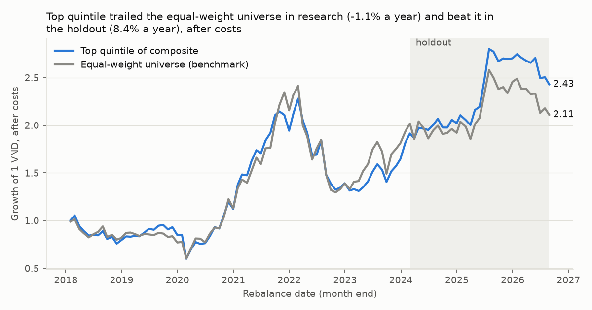

# vn-factor-ranking

Does a factor ranking predict next-month returns of liquid Vietnamese stocks once
look-ahead, survivorship and costs are handled honestly? A reproducible, point-in-time
pipeline (package `vnfactor`) that ranks the 100 most liquid HOSE stocks every month and
evaluates the ranking with rank IC, quintile spreads, a cost-aware backtest, walk-forward
Ridge and LightGBM, robustness checks and a holdout run exactly once.

## Results

The paragraph, figure and table below are generated by `python -m vnfactor report`.

<!-- results:start -->
Each month from Jan 2018 to Aug 2026 (104 rebalances), the 100 most liquid HOSE stocks are ranked on seven factors, and the ranking is tested against next-month returns without look-ahead. In the 31-month holdout, evaluated once, the equal-weight composite had a mean rank IC of 0.075 (t = 1.91) and its top quintile returned 11.8% a year after costs, against 3.4% for the equal-weight universe. In the 73-month research period the same portfolio trailed the benchmark (10.4% vs 11.5%) and the composite IC was 0.028 (t = 1.12), so the sign of the edge flips between periods. Machine learning did not reliably beat simple score averaging: in the holdout Ridge's top quintile returned 12.7% (above the composite) and LightGBM's -0.4% (below); on the research out-of-sample months they returned 6.2% and 5.1% against 9.8% for the composite. No t-statistic in this study reaches 2, so the evidence for any signal is weak.



Mean monthly rank IC (t-stat in brackets). Ridge, LightGBM and the second composite row use
the 36 research months where the models have
out-of-sample predictions, and all 31 holdout months.

| Signal | Research | Holdout |
| :-- | ---: | ---: |
| `mom_12_1` | -0.001 (-0.03) | 0.009 (0.20) |
| `rev_1m` | -0.017 (-0.74) | 0.011 (0.28) |
| `vol_126` | 0.012 (0.33) | 0.076 (1.55) |
| `adv_63` | 0.004 (0.18) | 0.004 (0.13) |
| `ep` | 0.038 (1.98) | 0.056 (1.82) |
| `bp` | 0.024 (1.03) | 0.021 (0.62) |
| `roe` | 0.015 (0.69) | 0.029 (0.75) |
| Composite (all research months) | 0.028 (1.12) | 0.075 (1.91) |
| Composite (out-of-sample months) | -0.010 (-0.24) | 0.075 (1.91) |
| Ridge (out-of-sample months) | -0.019 (-0.36) | 0.056 (1.44) |
| LightGBM (out-of-sample months) | -0.033 (-1.05) | 0.008 (0.33) |

Top quintile, CAGR after costs: research 10.4% vs benchmark 11.5%;
holdout 11.8% vs benchmark 3.4%.
<!-- results:end -->

Full report with every table and figure: [reports/report.md](reports/report.md).

## Method in brief

- **Data:** daily bars (adjusted prices, from 2017-01-03), daily traded value and quarterly
  statements from the `fhsc` Open API through `vnstock` 6.0.0. Choices are backed by a data
  audit ([docs/data_audit.md](docs/data_audit.md)).
- **Universe, rule-based at each month end:** HOSE stocks with 252 sessions of history that
  traded on 80% of the last 126 sessions; the top 100 by median traded value. Not today's
  index applied to the past.
- **Timing:** signals at the month-end close, trades at the next close, statements usable
  45 days after quarter end (as-of join). A test recomputes signals on data cut at each date
  and checks they do not change.
- **Factors (sign fixed in advance):** 12-1 momentum (+), 1-month reversal (−), 126-day
  volatility (−), 63-day liquidity (−), E/P (+), B/P (+), ROE (+). Winsorized at 1/99%,
  z-scored, value and quality within financials and non-financials separately.
- **Composite:** equal weight of momentum, volatility, value and quality groups.
- **Machine learning:** Ridge and LightGBM on the seven z-scores, label = monthly percentile
  rank of the forward return, expanding walk-forward refitted every 12 months, trained only
  on labels known at the prediction date, fixed hyperparameters.
- **Backtest:** long-only top quintile, equal weight, monthly, 0.15% per side plus 0.1% sell
  tax, against the equal-weight universe.
- **Split:** 73 research months (2018-01 to 2024-01), 31 holdout months (2024-02 to 2026-08)
  evaluated once after the method was frozen ([docs/methodology.md](docs/methodology.md)).

## Limitations

- **Survivorship bias, partly remaining:** candidates are today's VNINDEX constituents, so
  delisted stocks are missing. A robustness check shows how much a basket picked with
  hindsight inflates returns.
- **Pre-transfer history:** stocks that moved to HOSE from HNX or UPCoM bring their earlier
  history (selection bias; the source has no exchange history).
- **Restated figures:** the source may have restated past statements.
- **Market cap:** today's share count × past adjusted prices; E/P and B/P carry some future
  information around cash dividends and share issuance.
- **Traded value before August 2021 is estimated** from adjusted prices and raw volume,
  anchored to the first matched values.
- **Total equity:** B/P and ROE include minority interest (parent-only equity is not
  available in the free item set).
- **Short sample:** about 100 stocks, 73 research and 31 holdout months; no t-statistic is
  large enough to rule out chance, and seven factors were tested.
- **No short selling** (not available in Vietnam); Q5 − Q1 is a signal measure only.
- **Execution:** fills at the next close, ignoring the ±7% daily price limit, lot sizes and
  market impact.

## Reproduce

Windows PowerShell, Python 3.12:

```powershell
python -m venv .venv
.\.venv\Scripts\Activate.ps1
python -m pip install -e ".[dev]"
pytest                       # synthetic data only: no key, no network
```

Running on real data needs `vnstock` 6.0.0 and your own `fhsc` Open API key:

```powershell
python -m pip install -U --extra-index-url https://vnstocks.com/api/packages "vnstock==6.0.0" "vnstock-oapi==0.1.1"
vnstock keys set fhsc        # stores the key in the OS keyring
python -m vnfactor ingest    # 15:00-21:00 Vietnam time, sequential, resumable (~4 hours)
python -m vnfactor build
python -m vnfactor evaluate
python -m vnfactor ml
python -m vnfactor robustness
python -m vnfactor holdout   # refuses to run a second time
python -m vnfactor report
```

```
configs/base.yaml        every parameter
docs/                    data audit, methodology and decision log
scripts/data_audit.py    one-off audit of the data source
src/vnfactor/            client (only module importing vnstock), ingest, calendar,
                         universe, fundamentals, factors, pipeline, evaluation,
                         backtest, ml, report, cli
tests/                   synthetic-data tests, incl. no-look-ahead and walk-forward
reports/                 report.md, figures, aggregate tables
```

## Data and disclaimer

Market data is not included: the source's terms do not allow redistribution, and `data/` is
git-ignored. The repository holds code, figures and aggregate statistics only. The code is
MIT-licensed. This is a learning project, not investment advice.
