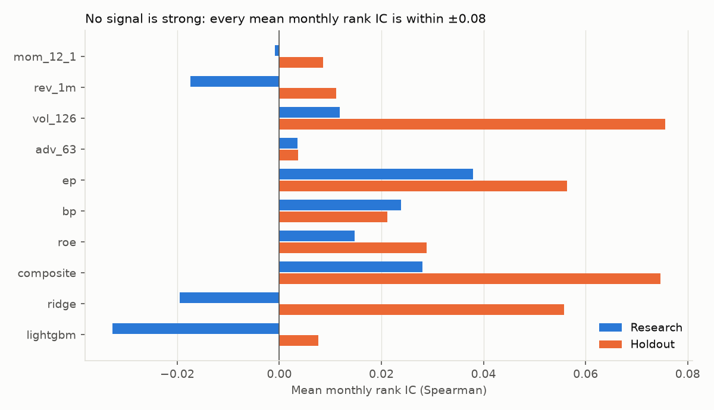
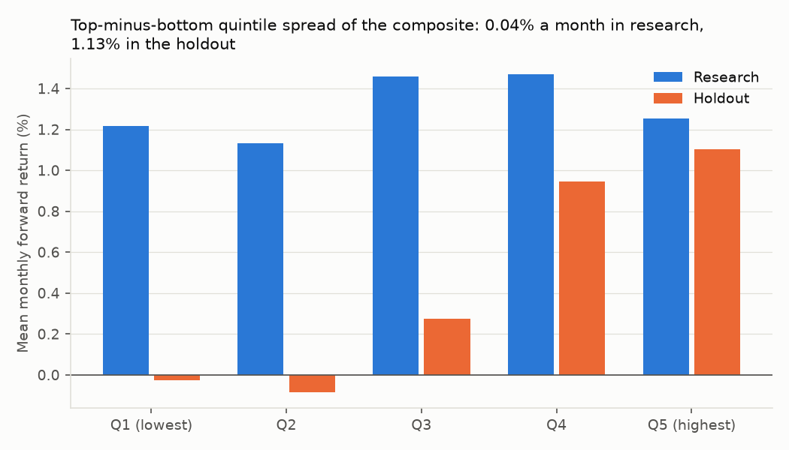
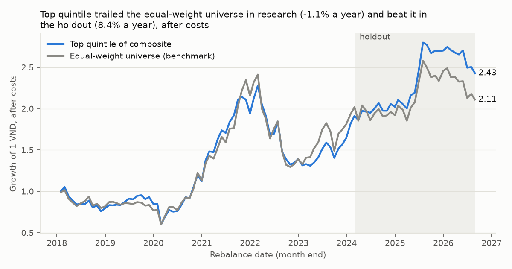

# Factor ranking on liquid HOSE stocks: full report

Generated by `python -m vnfactor report` from the tables in `reports/tables`. Method and
parameters are in `docs/methodology.md` (frozen before evaluation); data evidence is in
`docs/data_audit.md`. For education only; not investment advice.

## Summary

Each month from Jan 2018 to Aug 2026 (104 rebalances), the 100 most liquid HOSE stocks are ranked on seven factors, and the ranking is tested against next-month returns without look-ahead. In the 31-month holdout, evaluated once, the equal-weight composite had a mean rank IC of 0.075 (t = 1.91) and its top quintile returned 11.8% a year after costs, against 3.4% for the equal-weight universe. In the 73-month research period the same portfolio trailed the benchmark (10.4% vs 11.5%) and the composite IC was 0.028 (t = 1.12), so the sign of the edge flips between periods. Machine learning did not reliably beat simple score averaging: in the holdout Ridge's top quintile returned 12.7% (above the composite) and LightGBM's -0.4% (below); on the research out-of-sample months they returned 6.2% and 5.1% against 9.8% for the composite. No t-statistic in this study reaches 2, so the evidence for any signal is weak.

## Setup

- 104 monthly rebalances, 2018-01-31 to 2026-08-28:
  73 research months, then 31 holdout months.
- Universe: the 100 HOSE stocks with the highest 126-session median traded value, among
  stocks with 252 sessions of history that traded on 80% of recent sessions;
  196 distinct stocks enter it at some point.
- Signals at the month-end close; trades at the next close; returns to the close after the
  next month end. Statements count 45 days after quarter end.
- Costs: 0.15% per side plus 0.10% sell tax, on traded weight.

## 1. Single factors (research period)

Mean monthly rank IC, ICIR (mean / standard deviation), t-stat (ICIR × √months), share of
months with IC > 0, and the top-minus-bottom quintile spread per month. Signs are the
hypotheses fixed in advance, so a positive IC means the hypothesis held.

| Factor | Mean IC | ICIR | t-stat | IC > 0 | Q5 − Q1 | Holdout IC | Holdout t |
| :-- | ---: | ---: | ---: | ---: | ---: | ---: | ---: |
| `mom_12_1` | -0.001 | -0.00 | -0.03 | 53% | -0.02% | 0.009 | 0.20 |
| `rev_1m` | -0.017 | -0.09 | -0.74 | 42% | -0.80% | 0.011 | 0.28 |
| `vol_126` | 0.012 | 0.04 | 0.33 | 51% | -0.68% | 0.076 | 1.55 |
| `adv_63` | 0.004 | 0.02 | 0.18 | 53% | 0.45% | 0.004 | 0.13 |
| `ep` | 0.038 | 0.23 | 1.98 | 63% | 0.72% | 0.056 | 1.82 |
| `bp` | 0.024 | 0.12 | 1.03 | 47% | 1.41% | 0.021 | 0.62 |
| `roe` | 0.015 | 0.08 | 0.69 | 59% | 0.14% | 0.029 | 0.75 |

Seven factors were tested, so one or two t-statistics above 2 could appear by chance alone.
No factor reaches |t| ≥ 2 in the research period.



*No signal is strong: every mean monthly rank IC is within ±0.08*

## 2. Composite score

| Period | Q1 | Q2 | Q3 | Q4 | Q5 | Q5 − Q1 | t-stat |
| :-- | ---: | ---: | ---: | ---: | ---: | ---: | ---: |
| Research | 1.22% | 1.13% | 1.46% | 1.47% | 1.25% | 0.04% | 0.05 |
| Holdout | -0.03% | -0.08% | 0.28% | 0.95% | 1.10% | 1.13% | 1.30 |



*Top-minus-bottom quintile spread of the composite: 0.04% a month in research, 1.13% in the holdout*

## 3. Backtest: top quintile vs the equal-weight universe

Research period (73 months):

| Strategy | CAGR gross | CAGR net | Volatility | Sharpe (net) | Max drawdown | Excess CAGR (net) | Turnover / month |
| :-- | ---: | ---: | ---: | ---: | ---: | ---: | ---: |
| composite | 11.5% | 10.4% | 28.3% | 0.49 | -43.1% | -1.1% | 43% |
| benchmark | 11.9% | 11.5% | 29.7% | 0.52 | -46.3% | 0.0% | 14% |

Holdout (31 months):

| Strategy | CAGR gross | CAGR net | Volatility | Sharpe (net) | Max drawdown | Excess CAGR (net) | Turnover / month |
| :-- | ---: | ---: | ---: | ---: | ---: | ---: | ---: |
| composite | 12.8% | 11.8% | 15.7% | 0.79 | -13.3% | 8.4% | 37% |
| benchmark | 3.7% | 3.4% | 18.8% | 0.27 | -18.1% | 0.0% | 13% |

Turnover is the two-sided sum of absolute weight changes per month (the first month counts
the initial purchase). Sharpe uses a zero risk-free rate.



*Top quintile trailed the equal-weight universe in research (-1.1% a year) and beat it in the holdout (8.4% a year), after costs*

## 4. Machine learning vs the simple composite

Walk-forward, expanding window, refitted every 12 months, trained only on labels known at
the prediction date. Research out-of-sample months: 2021-02-26 to
2024-01-31 (36 months); the composite is evaluated on exactly the
same months. CAGR is the top quintile after costs.

| Model | Research IC | t | Research CAGR | Holdout IC | t | Holdout CAGR |
| :-- | ---: | ---: | ---: | ---: | ---: | ---: |
| composite | -0.010 | -0.24 | 9.8% | 0.075 | 1.91 | 11.8% |
| ridge | -0.019 | -0.36 | 6.2% | 0.056 | 1.44 | 12.7% |
| lightgbm | -0.033 | -1.05 | 5.1% | 0.008 | 0.33 | -0.4% |
| benchmark |  |  | 13.0% |  |  | 3.4% |

Average Ridge coefficients and LightGBM gain shares across research refits:

| Feature | Ridge coefficient | LightGBM gain share |
| :-- | ---: | ---: |
| `mom_12_1` | +0.0078 | 15% |
| `rev_1m` | -0.0058 | 17% |
| `vol_126` | +0.0154 | 15% |
| `adv_63` | -0.0006 | 12% |
| `ep` | +0.0108 | 13% |
| `bp` | +0.0029 | 12% |
| `roe` | -0.0004 | 16% |

With about 100 stocks a month and at most a few thousand training rows, the label is mostly
noise. Ridge coefficients stay close to zero, and LightGBM spreads its splits almost evenly
across features, which is what fitting noise looks like. Its higher turnover also makes
costs weigh more. Ridge uses NaN → 0 for missing features (the cross-sectional mean of a
z-score), the only place where missing values are filled.

## 5. Robustness (research period, one change at a time)

| Variant | Mean IC | t | Top CAGR net | Benchmark CAGR net | Excess | Overlap with base universe |
| :-- | ---: | ---: | ---: | ---: | ---: | ---: |
| `baseline` | 0.028 | 1.12 | 10.4% | 11.5% | -1.1% | 100% |
| `lag_90_days` | 0.028 | 1.09 | 11.6% | 11.5% | 0.1% | 100% |
| `costs_x2` | 0.028 | 1.12 | 9.2% | 11.1% | -1.9% | 100% |
| `current_liquid_basket` | 0.004 | 0.17 | 13.0% | 18.7% | -5.8% | 71% |

- Reporting lag of 90 days instead of 45: mean IC 0.028 vs
  0.028, top-quintile CAGR 11.6% vs
  10.4%.
- Doubling costs lowers the top-quintile CAGR from 10.4% to
  9.2% a year.
- Survivorship: picking the universe with hindsight (the 100 most liquid stocks on the
  last day, applied to the past) raises the benchmark's research CAGR from
  11.5% to 18.7%. That gap is the
  size of the bias a hindsight universe would have added.

## 6. Holdout

Run record:

```text
holdout run at 2026-11-14 21:32:33 Vietnam time
code: ef3ced7 with uncommitted changes
period: 31 rebalance dates, 2024-02-29..2026-08-28
```

The holdout used the frozen method and parameters, and nothing was changed after it ran.
With 31 months, a difference in CAGR of a few points a year is within
the range that chance alone produces; read the holdout as a consistency check, not as proof.

## 7. Conclusions

1. Single factors: the evidence for cross-sectional predictability is weak. The factor
   with the best worse-of-two-periods t-stat is `ep` (research
   1.98, holdout 1.82); no
   factor clears |t| ≥ 2 in both periods, and seven tests were run.
2. Composite vs machine learning, top-quintile CAGR after costs on the same months: research
   composite 9.8%, ridge 6.2%, lightgbm 5.1%; holdout
   composite 11.8%, ridge 12.7%, lightgbm -0.4%. Models that beat the
   composite: research none; holdout
   ridge. Worst: lightgbm in research, lightgbm in the
   holdout.
3. After costs, the top quintile beat the
   equal-weight universe in the holdout and trailed
   it in research; the sign changes between periods, so no stable edge is shown.

## Limitations

- **Survivorship bias, partly remaining.** Candidates are today's VNINDEX constituents;
  delisted stocks are missing. The robustness check shows how much a basket picked with
  hindsight flatters returns.
- **Pre-transfer history.** Stocks that moved to HOSE from HNX or UPCoM bring their earlier
  history, so the universe can hold a stock that was not on HOSE at the time, and that history
  is conditioned on later success (selection bias).
- **Restated figures.** Statement values may have been restated by the source.
- **Market cap formula.** Today's share count times past adjusted prices puts future
  information into E/P and B/P around cash dividends and share issuance.
- **Estimated traded value before August 2021.** An anchored proxy from adjusted prices and
  raw volume; corporate actions between 2017 and the anchor are not undone.
- **Total equity.** B/P and ROE include minority interest.
- **Short sample.** About 100 stocks, 73 research months and 31 holdout months.
- **No short selling.** Q5 − Q1 is a signal measure, not a tradable return.
- **Execution.** Trades at the close of the next session, ignoring the ±7% price limit, lot
  sizes and market impact.
